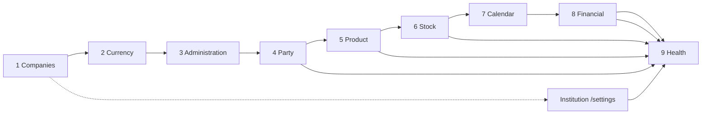
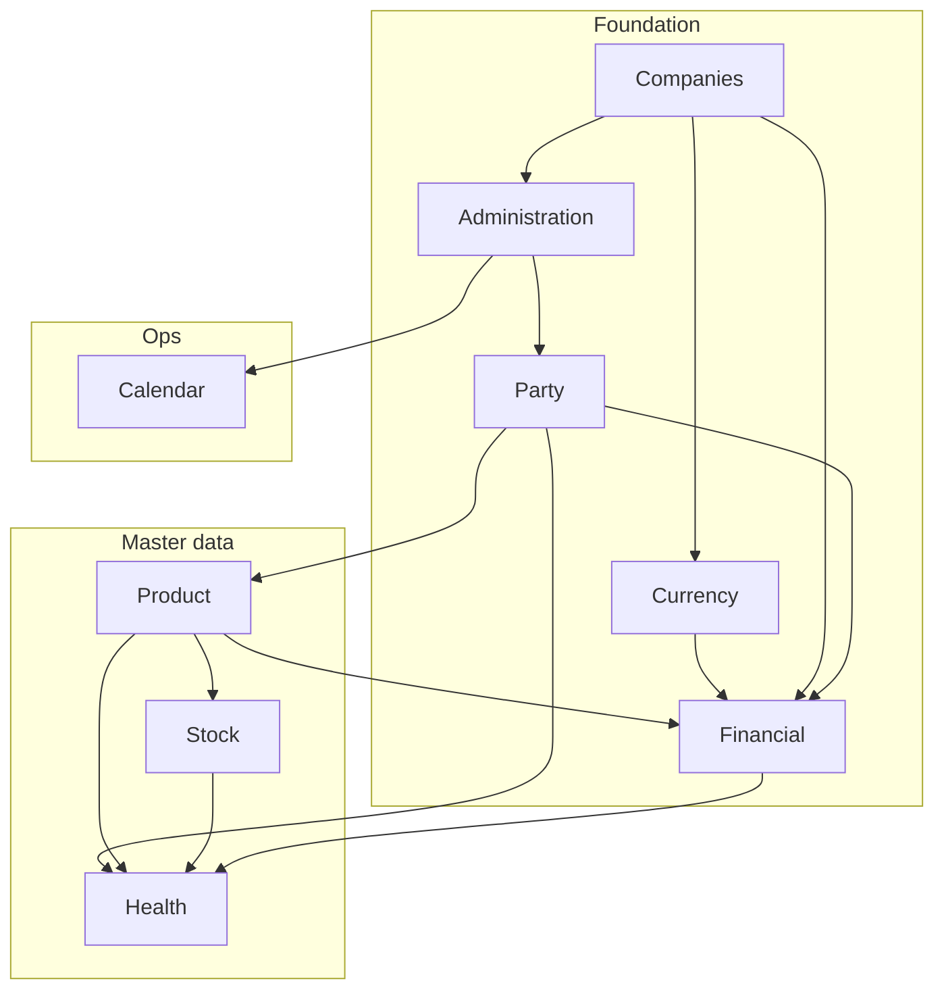

# Module Setup Dependencies — IST Health (UAE / Qatar)

**Version:** 1.0.0  
**Date:** 2026-07-14  
**Stack:** GNU Health HIS 5 / Tryton 7 + IST React frontend  
**Rule:** Do not invent GNU Health capabilities or tax/regulatory rates. Mark uncertain items **needs confirmation**.  
**Related:** `docs/implementation/financial-setup.md`, `frontend/docs/SAO_MIGRATION.md`, `docs/research/gnuhealth-module-dependency-map.md`

## 1. Purpose

Guide a **new UAE/Qatar deployment** through sidebar Menus (Party, Product, Financial, Currency, Inventory & Stock, Calendar, Companies, Health, Administration) so setup of one module enables — and does not block — the next.

**Where to click in UI**

| Entry | Route / action |
|-------|----------------|
| **Setup Hub** (Favorites) | `/setup` |
| Help overview | `/help?topic=wf-system-setup` |
| Financial deep runbook | `docs/implementation/financial-setup.md` + `/financial` |
| SAO (wizards) | `/sao/` same host; deep CoA / fiscal / journals stay SAO-only |

---

## 2. Recommended setup order (new deployment)

Perform **once per legal company** (UAE AED entity and Qatar QAR entity separately unless counsel says otherwise).

| # | Module | React | SAO required? |
|---|--------|-------|---------------|
| 1 | **Companies** | `/companies` | Deep company options |
| 2 | **Currency** | `/currency` | Create missing currencies |
| 3 | **Administration** | `/users`, `/groups`, `/sequences`, `/modules`, `/countries`, `/languages` | Module activate/upgrade; ACL wizards |
| 4 | **Party** | `/parties` | Accounting defaults, categories |
| 5 | **Product** | `/products` | Templates, UoM, account categories |
| 6 | **Inventory & Stock** | `/stock` | Locations, warehouses, lots |
| 7 | **Calendar** | `/calendar` | Calendar ownership / sharing |
| 8 | **Financial** | `/financial` | **CoA, FY, periods, journals, taxes, post/pay** |
| 9 | **Health** | `/patients`, `/appointments`, `/laboratory`, `/pharmacy`, `/beds`, … | Institutions, beds, lab types, deep clinical |

Institution/facility (`gnuhealth.institution`) usually follows companies (Settings `/settings` or SAO) before full Health go-live — see §3.9.

---

## 3. Per-module setup

### 3.1 Companies

| | |
|--|--|
| **Purpose** | Legal entity (`company.company`) + party; scopes accounting, stock, and users. |
| **Prerequisites** | DB with Tryton `company` module; admin login. |
| **React** | `/companies` — list + setup wizard lite (creates party + company). |
| **SAO** | Full company options, employee links, header/logo. |
| **Verify** | UAE and/or Qatar company listed; currency set to AED or QAR. |

### 3.2 Currency

| | |
|--|--|
| **Purpose** | Monetary units for company and invoices. |
| **Prerequisites** | Companies planned (currency assigned on company). |
| **React** | `/currency` — list/search. |
| **SAO** | Create AED / QAR if missing; rates if multi-currency used (**needs confirmation** for rate source). |
| **Verify** | AED present for UAE entity; QAR for Qatar entity. |

### 3.3 Administration (users / groups / sequences / modules)

| | |
|--|--|
| **Purpose** | Access control, document numbering, module activation. |
| **Prerequisites** | At least one company if users are company-scoped. |
| **React** | `/users`, `/groups`, `/sequences`, `/modules`, `/countries`, `/languages`. |
| **SAO** | Apply module activate/upgrade; deep ACL / record rules. |
| **Verify** | Role users can open Menus; sequences exist for invoices/patients as required; modules listed match discovery (`account_*`, `stock`, `health_*`). |

### 3.4 Party

| | |
|--|--|
| **Purpose** | People and organizations (`party.party`) — patients, suppliers, insurers, company party. |
| **Prerequisites** | Company; ideally currency. |
| **React** | `/parties` — list. |
| **SAO** | Categories, addresses, receivable/payable (after CoA). |
| **Verify** | Synthetic parties only in non-prod (`IST-*` / `SYN-*`). |

### 3.5 Product

| | |
|--|--|
| **Purpose** | Goods/services (`product.template` / `product.product`) for pharmacy, lab, billing lines. |
| **Prerequisites** | Company; Party for suppliers; Administration sequences as needed. |
| **React** | `/products` — list. |
| **SAO** | Templates, UoM, categories, account category (after Financial CoA). |
| **Verify** | Clinical/service products exist for smoke tests; no invented price lists as regulatory. |

### 3.6 Inventory & Stock

| | |
|--|--|
| **Purpose** | Locations, moves, lots (`stock.*`, `health_stock*`). |
| **Prerequisites** | Company; Products; warehouses/locations. |
| **React** | `/stock` — locations/moves list. |
| **SAO** | Warehouse structure, inventory adjustments, lot config. |
| **Verify** | Facility location under correct company; receive/transfer smoke (Help `wf-receive-stock`). |

### 3.7 Calendar

| | |
|--|--|
| **Purpose** | Calendars/events (`calendar.*`); Health may use `health_calendar` / inpatient calendar modules. |
| **Prerequisites** | Users/parties who own calendars; company context. |
| **React** | `/calendar` — list (may be empty). |
| **SAO** | Create calendars, permissions. |
| **Verify** | Calendar visible if module active; appointments still use `/appointments` (clinical model). |

### 3.8 Financial

| | |
|--|--|
| **Purpose** | Invoices and GL foundation for billing. |
| **Prerequisites** | Company + currency; Party; preferably Product account categories. |
| **React** | `/financial` — invoice list + **draft stub** + setup checklist. |
| **SAO** | **Required:** CoA from template, fiscal year/periods, journals, taxes, post/pay, period close. |
| **Verify** | Follow `financial-setup.md` smoke test. Tax rates: **needs confirmation** — do not invent. |

### 3.9 Health (and key sub-areas)

| Sub-area | React | Depends on | Notes |
|----------|-------|------------|-------|
| Institution / units | `/settings` | Companies | `gnuhealth.institution` |
| Patients | `/patients` | Party, Company, Sequences | Synthetic IDs in non-prod |
| Appointments | `/appointments` | Patients, Staff, Calendar optional | Clinical schedule |
| Staff / HP | `/staff` | Party, Company | Health professionals |
| Laboratory | `/laboratory` | Patients, Products (tests), Stock optional | `health_lab` |
| Pharmacy / Rx | `/pharmacy`, `/medications` | Patients, Products, Stock | Dispense needs stock |
| Beds / inpatient | `/beds` | Institution, Patients | `health_inpatient` |
| Nursing / procedures / imaging | `/nursing`, `/procedures`, `/imaging` | Patients + specialty modules | Per discovery map |

**Prerequisites for Health go-live:** Companies → Admin users → Party → Product → Stock (for pharmacy) → Financial (if charging) → Institution.

**SAO:** Deep clinical wizards, bed configuration, lab test types, insurance plan detail.

**Verify:** Create synthetic patient → book appointment → lab order → Rx (Help workflows).

---

## 4. Impact matrix (Module A → Module B)

| If you set up A… | Enables in B | Blocks / breaks if missing |
|------------------|--------------|----------------------------|
| **Companies** | Currency assignment; Party company; Stock locations; Financial CoA; Health institution linkage; user company | Multi-entity AE/QA isolation; posting invoices; company-scoped stock |
| **Currency** | Company currency; invoice amounts | Wrong/missing AED/QAR on company |
| **Administration** | Users open Menus; sequences for docs; modules active | Empty menus; cannot activate `health_*` / `account_*` |
| **Party** | Patients, suppliers, insurers, invoice party | Patient create; invoice stub; stock counterparties |
| **Product** | Stock moves; invoice lines; lab/pharmacy catalogs | Empty stock/pharmacy; service billing lines |
| **Stock** | Pharmacy dispense; inpatient stock; transfers | Dispense/receive workflows |
| **Calendar** | Calendar UI / some health calendar features | Appointments still work via `/appointments` without calendar records |
| **Financial** | Posted invoices; receivables; service billing | Draft-only or failed stub if CoA/FY missing |
| **Health** | Clinical ops; may drive services → invoices | Does not replace CoA; claims e-submit is separate gap (G-14) |

---

## 5. Cross-country notes (AE vs QA)

| Topic | UAE | Qatar | Status |
|-------|-----|-------|--------|
| Legal company | Separate `company.company` | Separate | Configure |
| Currency | **AED** | **QAR** | Required |
| CoA template | Confirm with finance | Confirm | **Needs confirmation** |
| Tax / VAT on clinical services | Do not invent rates | Do not invent | **Needs confirmation** |
| National ID formats | Synthetic `SYN-AE-*` in non-prod | Synthetic `SYN-QA-*` | Demo policy |
| HIE / claims | NABIDH/Malaffi/Riayati / eClaim | MoPH / local | **Needs confirmation** (gaps G-01…G-14) |
| Language | EN + AR | EN + AR | Supported |

Do **not** share one CoA or warehouse across UAE and Qatar entities without an explicit legal/accounting decision.

---

## 6. React vs SAO ownership (summary)

| Task | Owner |
|------|--------|
| Lists, company wizard lite, invoice draft stub, Setup Hub | **React** |
| CoA, fiscal year, journals, taxes, post/pay, period close, module apply | **SAO** |
| Guided narrative | Help `wf-system-setup`, per-area `setup-*`, `wf-finance-setup` |

---

## 7. Related artefacts

- Runbook: `docs/implementation/financial-setup.md`  
- Guide: `docs/implementation/UAE_Qatar_Implementation_Guide.md`  
- Gaps: `docs/research/gap-analysis-uae-qatar.md` (G-12 tenancy, G-16 finance)  
- Roles: `docs/user-guides/roles/system-admin.md`, `facility-admin.md`  
- UI: `/setup`, `/help?topic=wf-system-setup`  
- SAO map: `frontend/docs/SAO_MIGRATION.md`

## 8. Exit criteria

- [ ] Setup Hub `/setup` lists all modules with routes + help links  
- [ ] Order 1–9 completed for each target legal company  
- [ ] Financial smoke test passed per `financial-setup.md`  
- [ ] Health smoke: patient + appointment (+ lab/Rx if in scope) on synthetic data  
- [ ] Tax / HIE / national-ID rules still marked **needs confirmation** until counsel signs off  
