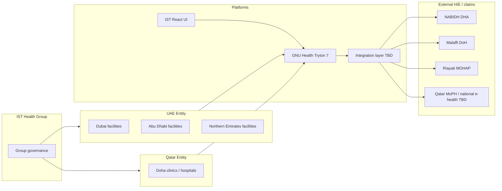

# Gap Analysis — UAE & Qatar vs IST Health / GNU Health

**Date:** 2026-07-14  
**Method:** Map regulatory/program expectations (official sources where cited) to current IST stack. Uncertain legal items marked **needs legal confirmation**.

## Target architecture (proposed)

## Gap register (summary)

| ID | Requirement | Country | Authority | Mandatory? | GH support | Gap | Action |
|----|-------------|---------|-----------|------------|------------|-----|--------|
| G-01 | Connect to Dubai HIE (NABIDH) if licensed in Dubai | UAE-DXB | DHA | **Needs confirmation** per facility license | None | No HL7/FHIR gateway | Design interface; engage DHA onboarding |
| G-02 | Abu Dhabi HIE (Malaffi) | UAE-AUH | DoH | **Needs confirmation** | None | Same | Engage Malaffi / DoH |
| G-03 | Federal HIE (Riayati) / NUMR | UAE | MOHAP | **Needs confirmation** | None | Same | Align coding standards doc v2.1 |
| G-04 | HL7 v2 and/or FHIR for HIE | UAE | DHA/MOHAP docs | Recommended in published standards | None native as HIE client | Build/buy interface engine | Prefer reusable integration service |
| G-05 | C-CDA clinical documents | UAE-DXB | DHA NABIDH IG | Per IG — confirm | None | Document generation | Map evaluations/labs → C-CDA |
| G-06 | Terminology (ICD, LOINC, SNOMED…) | UAE | Riayati coding standards | Per program | ICD modules available; SNOMED/LOINC not verified | Licensing + maps | Confirm licenses; map catalogs |
| G-07 | Qatar facility licensing / MoPH e-health | QA | MoPH | **Needs confirmation** | Partial HIS | Unknown mandate set | Formal MoPH inquiry |
| G-08 | Qatar PDPPL special-nature health data | QA | NDPO / NCSA | Likely applicable — **confirm** | Technical controls partial | DPIA, permits, retention | Security controls doc + counsel |
| G-09 | UAE PDPL sensitive personal data | UAE | Federal PDPL | **Needs confirmation** of scope/exemptions | Partial | Same | Counsel + DPIA |
| G-10 | National ID capture rules | UAE/QA | Multiple | **Needs confirmation** | Generic IDs only | Validation & consent UX | Synthetic formats only in demos |
| G-11 | Bilingual clinical documentation | Both | Practice / regulator TBD | Recommended | Partial | Translation completeness | Expand i18n |
| G-12 | Multi-entity tenant isolation | Both | Governance | Recommended | Tryton company/rules unused | Cross-entity leakage risk | Org model + record rules |
| G-13 | Audit logging for clinical access | Both | Privacy laws | Likely expected — **confirm** | Tryton history partial | No dedicated privacy audit UI | Enhance logging |
| G-14 | Claims / insurance e-submission | UAE | eClaim / DHA schemes | **Needs confirmation** | `health_insurance` local only | No e-claim connector | Partner integration |
| G-15 | DICOM / PACS | Both | Clinical ops | Optional unless imaging | Orthanc package exists | Not wired in IST React | Optional Orthanc deploy |
| G-16 | Financial / GL setup per legal entity | Both | Finance / ops | Required for posting invoices | Tryton `account_*` + `health_accounting` | React `/financial` is stub; CoA/FY/journals/taxes SAO-only; tax rates **needs confirmation** | Follow `docs/implementation/financial-setup.md`; Help `wf-finance-setup` |
| G-17 | Cross-module setup order & operator UX | Both | Ops / admins | Required for new deployments | Menus exist; Setup Hub added | Operators may start Health/Financial before Company/Currency/CoA | Follow `docs/implementation/module-setup-dependencies.md`; React `/setup`; Help `wf-system-setup` |

## Priority remediation

1. **Governance:** Legal confirmation of G-01…G-09, G-14 (and tax items under G-16).  
2. **Tenancy:** Implement group → UAE/QA → facility model (implementation guide).  
3. **Integration service:** External HL7/FHIR adapter (do not upgrade GH core).  
4. **Data controls:** Enforce synthetic-only demos; production import gates.  
5. **Evidence:** VM module activation report.  
6. **Finance:** Complete CoA / fiscal / journals per company via SAO before UAT billing.  
7. **Module setup order:** Use Setup Hub `/setup` and `module-setup-dependencies.md` so Company/Currency/Admin precede Party/Product/Stock/Financial/Health.

## What is already strong

- Modern React UI with EN/AR RTL.  
- Core ambulatory workflows mapped to GH models.  
- Synthetic data engine with deterministic seed.  
- Ops/admin parity for users/groups/modules listing.
