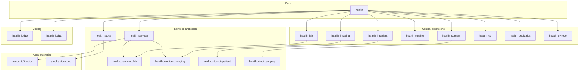

# GNU Health Module Dependency Map (Planning)

**Source:** Official features list + IST `activate_modules.sh` batching.  
**Note:** Exact Tryton `depends` graphs should be verified from installed `tryton.cfg` on the VM. This map is a **planning** view, not a dump of `ir.module.dependency`.

## Activation order (IST script)

1. Tryton: `account`, `account_product`, `account_invoice`, `stock`, `stock_lot`  
2. Clinical core batch (see discovery doc)  
3. Remaining `health_*` not yet activated  

## Custom modules

None in `C:\HMS`. Future UAE/QA connectors should be **separate** Tryton modules or an external integration service — do not fork core `health` without a governance decision.
