# GNU Health Module Dependency Map (IST HIS baseline)

**Upstream version:** 5.0.6  
**Generated:** 2026-07-14  

Dependencies parsed from each module `tryton.cfg` in tag `v5.0.6`.

```mermaid
flowchart TD
  health --> health_archives
  health_webdav3_server --> health_caldav
  health --> health_calendar
  health_caldav --> health_calendar
  health --> health_contact_tracing
  health --> health_crypto
  health_crypto --> health_crypto_lab
  health_lab --> health_crypto_lab
  health --> health_dentistry
  health --> health_disability
  health_socioeconomics --> health_disability
  health --> health_ems
  health --> health_federation
  health --> health_genetics
  health_genetics --> health_genetics_uniprot
  health --> health_gyneco
  health --> health_history
  health --> health_icd10
  health --> health_icd10pcs
  health --> health_icd11
  health --> health_icd9procs
  health --> health_icpm
  health --> health_icu
  health_inpatient --> health_icu
  health --> health_imaging
  health_imaging --> health_imaging_worklist
  health --> health_inpatient
  health_lifestyle --> health_inpatient
  health_inpatient --> health_inpatient_calendar
  health_calendar --> health_inpatient_calendar
  health --> health_insurance
  health_services --> health_insurance
  health --> health_iss
  health --> health_lab
  health --> health_lifestyle
  health --> health_mdg6
  health_lab --> health_mdg6
  health --> health_ntd
  health_lab --> health_ntd
  health_ntd --> health_ntd_chagas
  health_ntd --> health_ntd_dengue
  health --> health_nursing
  health --> health_ophthalmology
  health_imaging --> health_orthanc
  health --> health_pediatrics
  health_pediatrics --> health_pediatrics_growth_charts
  health_pediatrics_growth_charts --> health_pediatrics_growth_charts_who
  health --> health_qrcodes
  health_pediatrics --> health_qrcodes
  health_lab --> health_qrcodes
  health --> health_reporting
  health --> health_services
  health_imaging --> health_services_imaging
  health_services --> health_services_imaging
  health_lab --> health_services_lab
  health_services --> health_services_lab
  health --> health_socioeconomics
  health --> health_stock
  health_stock --> health_stock_inpatient
  health_inpatient --> health_stock_inpatient
  health_nursing --> health_stock_nursing
  health_stock --> health_stock_nursing
  health_stock --> health_stock_surgery
  health_surgery --> health_stock_surgery
  health --> health_surgery
  health_lab --> health_surgery
  health_imaging --> health_surgery
  health_icd10 --> health_surgery_protocols
  health_surgery --> health_surgery_protocols
  health --> health_who_essential_medicines
```

## Notes

- Non-health Tryton deps (`party`, `company`, `stock`, …) omitted from diagram for readability.
- `health_accounting` / `health_profile` / `health_imaging_orthanc` are **not** in the release tree.
